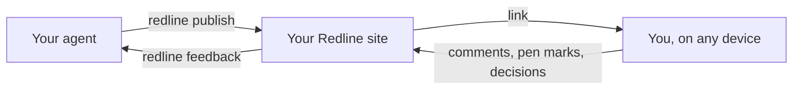

# Contributing to The Redline

Thanks for helping. Bug reports, fixes, new hosts and support for more agents are all welcome. For anything bigger than a small fix, open an issue first so we can agree on the shape before you spend time on it.

## How the code is laid out

| Folder | What is in it |
|---|---|
| `site/src/` | The review site: one fetch handler (`app.js`) that serves pages and the API for comments, pen marks and decisions |
| `site/src/stores/` | Where data lives: SQLite with files on disk, Postgres, and the shims that make them look like Cloudflare D1 and KV |
| `site/node/`, `site/api/`, `site/netlify/`, `site/src/worker.js` | The same handler started on Node, Vercel, Netlify and Cloudflare |
| `site/public/_redline/` | The layer drawn on top of every page: comments, pins, the pen, decisions (`redline.js`, `redline.css`) |
| `cli/` | The `redline` command. No dependencies; `cli/vendor/` holds the two small libraries it includes |
| `cli/deploy/` | One file per host. Each drives that host's own command-line tool |
| `skills/`, `agents/` | What the agent is told: the Claude Code skills, and the same instructions for Codex and other agents |
| `test/` | Everything below |

When someone opens a page, the site adds a script that draws the comment, pen and decision tools on top. `redline feedback` reads everything back, and opens the page in Chrome to take screenshots of the pen marks.

## Running the tests

You need Node.js 22.13 or newer. Run `npm install` once inside the `site` folder.

- `npm test` runs the command-line tests, the storage and host adapters, and the deploy modules against stand-in command-line tools. It takes about a minute and needs nothing else.
- `npm run test:site` runs the full site check against the Node server on SQLite and on Postgres (a Postgres that runs inside Node, so you don't install one).
- `node test/site.mjs` runs the same check against the Cloudflare Worker under `wrangler dev`.
- `node test/pencil.mjs` and `node test/e2e.mjs` drive Google Chrome headless, with simulated iPad touch and Apple Pencil input. They need Chrome installed (set `REDLINE_CHROME` if it isn't in the usual place). You don't need an iPad.

A pull request should keep all of these passing. If you change something people see, add a screenshot to the pull request.

## Adding a host

Copy `cli/deploy/vercel.mjs` as a starting point. A host module exports `deploy(opts)` and returns `{ url, key, dashboard }`. Take the host's command-line tool path from an environment variable, so tests can swap in a fake one the way `test/fake-vercel.mjs` does, and add the host's facts and limits to `docs/hosting.md`. If the host can run Node with a disk, the `Dockerfile` may already be enough, and a short section in `docs/hosting.md` is the whole contribution.

## Adding an agent

The instructions every agent gets are in `agents/redline.md`. A test checks that the Claude Code skill in `skills/redline/SKILL.md` says the same thing, so change both together. Then add an `install` target in `cli/redline.mjs` that puts the instructions where that agent looks for them, with a test in `test/cli-local.mjs`.

## Writing

Text people read (messages, buttons, docs) should be short and plain. Say what happened and what to do next. Avoid jargon where a plain word works.

## Security

Please don't open a public issue for a security problem. See [SECURITY.md](SECURITY.md).
