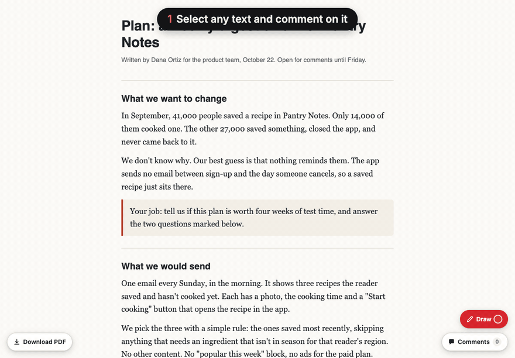
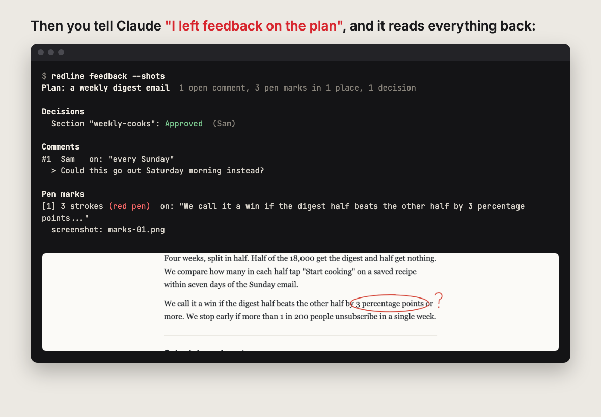
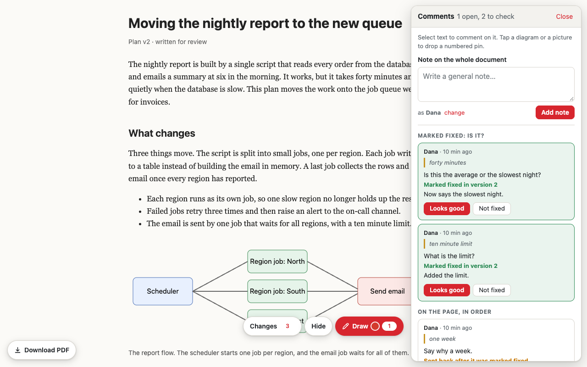
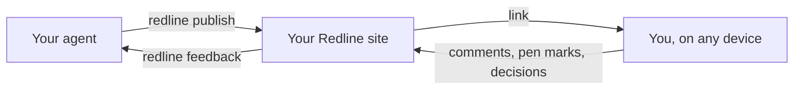

<p align="center"></p>

Review what your coding agent writes with comments, pen marks and approvals, on your laptop, phone or iPad. Your agent gets your exact feedback, makes the changes, and shows you what it fixed. Works with Claude Code, Codex and other coding agents.

Runs on your own computer. No account needed.

<p align="center"></p>

## Who it's for

- You have an agent write plans, specs, designs or reports, and you want to read and mark them up properly instead of skimming them in a terminal.
- You review on an iPad or a phone, or you think faster with a pen than a keyboard.
- You need a yes or no from someone who doesn't use your tools, like a co-founder, a client or a designer, and you want their answer to reach your agent.
- You use more than one Claude account, sign in with an API key or a cloud provider, or switch between Claude Code and Codex, and you want all your reviews in one place.

## Why not Claude's artifacts?

Claude Code can publish a page as an [artifact](https://code.claude.com/docs/en/artifacts) on claude.ai. Artifacts are great for dashboards, live status pages and sharing results with your team. The Redline does a different job: reviewing a document and getting precise feedback back to your agent.

| | Claude artifacts | The Redline |
|---|---|---|
| Who can comment | People with a claude.ai account and access to the artifact. Anyone who opens a public link can't see or add comments. | Anyone with the link, no account needed |
| Pen markup, and Approve or Reject on each section | No | Yes, and the agent gets a screenshot of each marked spot |
| Checking the fix | Claude can reply to and resolve comment threads | Each fixed comment waits for your "Looks good", a Changes switch shows what is different, and an approval on edited text is flagged |
| Accounts and hosting | Needs a Pro, Max, Team or Enterprise login. The artifact lives in the account that published it, on Anthropic's servers. Sessions on an API key, Amazon Bedrock or Google Vertex can't publish. | Works with whatever Claude login or model provider you use, and with Codex. Your pages live on your computer or your own host, in one place for every account. |

The Redline is also open source, so you can change the review tools, the look and the domain. Facts about artifacts are from [Anthropic's documentation](https://code.claude.com/docs/en/artifacts), October 2026.

## Try it

You need Node.js 22.13 or newer. Google Chrome is optional: with it, every page gets a PDF and your agent gets a screenshot of each pen mark, so it can read your handwriting. Without it, the agent still gets the words each mark covers, but not the drawing.

In Claude Code, run:

```
/plugin marketplace add kidusketema/the-redline
/plugin install redline@the-redline
```

Then ask for a review:

> Publish the onboarding plan for review.

The first time, The Redline starts on your computer by itself, and your agent replies with a link. Mark the page up, then tell it "I left feedback".

For Codex, install the command and the Codex skill:

```
npm install -g github:kidusketema/the-redline
redline install codex
```

For any other agent, `redline install agents` prints a short block of instructions to paste into your `AGENTS.md`.

## Review on an iPad or phone

Run `redline phone` (or ask your agent to). It prints a link and a QR code; scan it with a device on the same Wi-Fi. Your computer has to stay awake while you review. To review from anywhere, or to send a page to someone else, put The Redline on a host (below).

## What you get

- Comments on any text, including the text inside diagrams, and numbered pins on pictures.
- Pen markup that feels right with an Apple Pencil: pressure, palm rejection, a hover dot that shows where the tip will land, three pen sizes, a highlighter and an eraser. A mouse or a finger works too.
- Approve, Reject and Not sure buttons, on the whole page or on each section that needs a decision.
- Markdown files work as they are. HTML pages work too, so your agent can draw diagrams and charts for you to mark up.
- A Download PDF button on every page, and a private dashboard of everything you have published.

Your agent reads it all back: each comment with the words it is attached to, each pen mark with the words it covers and a screenshot of the spot, and every decision.

<p align="center"></p>

When the agent publishes the next version, the link stays the same. Each comment it fixed waits for you to press "Looks good" or "Not fixed", the Changes switch highlights what is different, and an approval on a section that has changed since is flagged for a fresh look.

<p align="center"></p>

## Why it exists

Long agent output is hard to review in a terminal or a chat window. You scroll back and forth, lose your place, and end up typing "in the third section, the second bullet about pricing". With The Redline you point at the thing instead.

It started as a tool its author uses every day to review game design documents on an iPad Pro, which is why the pen got so much attention. This is the first public release (0.1).

## Put it on a host

Your computer is enough when you review on your own Wi-Fi. For links that work anywhere, run one of these, or run `/redline:setup` in Claude Code and pick a host:

| Host | Command | Where the data goes |
|---|---|---|
| Vercel | `redline deploy vercel` | Postgres: Neon from the Vercel Marketplace, or Supabase |
| Netlify | `redline deploy netlify` | Postgres: Netlify Database, or Supabase |
| Cloudflare | `redline deploy cloudflare` | Cloudflare D1 and KV, on the free plan with no card |
| Railway, Render, Fly, Coolify or any server | the `Dockerfile` in this repository | SQLite on a volume, or any Postgres |

Each one uses the host's own command-line tool and sign-in. Afterwards, `redline copy` moves the pages you already have, with their feedback. A page keeps its address on the new site, so `127.0.0.1:4848/k3v…/` becomes `your-site.vercel.app/k3v…/`. Limits and details for each host are in [docs/hosting.md](docs/hosting.md). The biggest single file is 25 MB, or about 4.5 MB on Vercel and Netlify.

## Commands

Your agent runs these for you. To type them yourself, install the command with `npm install -g github:kidusketema/the-redline`.

| Command | What it does |
|---|---|
| `redline publish plan.md --title "Onboarding plan"` | Publish a Markdown or HTML file, or a folder, and print its link |
| `redline publish plan.md --slug <slug>` | Publish a new version at the same link |
| `redline feedback <link> --shots` | Print every comment, pen mark and decision, with a screenshot of each marked spot |
| `redline feedback <link> --changes` | Also list the text that changed since the version before |
| `redline resolve <link> <number> --note "Moved to Friday"` | Mark a comment fixed, with a note on what changed |
| `redline phone` | Show the link and QR code for your iPad or phone |
| `redline list` | Everything you have published, with what still needs an answer |
| `redline dashboard` | Print the link to your private dashboard |
| `redline deploy <host>` | Put the site on Vercel, Netlify, Cloudflare or Docker |
| `redline copy` | Copy the pages on this computer to your host |
| `redline relink <slug>` | Give a page a new link and turn the old one off |
| `redline delete <slug> --yes` | Delete a page and all its feedback |

`redline help` lists the rest.

## Apple Pencil

Writing works in Safari on any iPad. Your palm and fingers scroll the page while the Pencil draws. Hold the Pencil still for half a second to open the colours, and tap with two fingers to undo.

Safari doesn't pass double-tap, squeeze, barrel roll or haptics to websites, and every browser on iPad uses Safari's engine, so no web page can use them. On a 120 Hz iPad, ink is smoother if you open Settings, then Apps, Safari, Advanced, Feature Flags, and turn off "Prefer Page Rendering Updates near 60fps".

## Privacy

Each page lives at its own random 24-character link. There is no public list of pages, search engines are told not to index them, and the link isn't passed on when someone clicks out of a page. Anyone who has a link can read that page and comment on it, so share links the way you would share an unlisted video, and don't publish passwords or other secrets. `redline relink` turns off a link you shared by mistake.

Anyone with the link can also press Approve. An approval records the name the reviewer typed and the version they saw, which is enough for a team that trusts each other, but it isn't a signed-in sign-off.

Only you can publish, change or delete pages. That takes the key saved in `~/.redline/config.json`, so treat that file like a password. The site sends nothing anywhere else: no analytics, no outside scripts, no calls home.

On your computer, only that computer can open your pages until you run `redline phone`. After that, anyone on the same Wi-Fi who has a link can open that page; `redline phone --off` stops it.

Comments come from whoever has the link. The instructions The Redline gives your agent tell it to treat them as notes about the document and never as commands to run.

## How it works

The site is one small web app. It runs as a Node server on your computer or any server, as a Cloudflare Worker, or as a Vercel or Netlify function, and keeps pages, comments, pen marks and decisions in SQLite, Postgres or Cloudflare D1. When someone opens a page, the site adds a script that draws the comment, pen and decision tools on top. `redline feedback` reads everything back, and opens the page in Chrome on your computer to take screenshots of the pen marks.



## Similar tools

[Plannotator](https://github.com/backnotprop/plannotator) reviews agent plans and code diffs in your desktop browser, and works with more agents. The Redline is for reviewing away from the keyboard: on an iPad or phone, with a pen, at a link that stays the same across versions, with a recorded answer on each decision. [Agentation](https://github.com/benjitaylor/agentation) and [React Grab](https://github.com/aidenybai/react-grab) let you point at parts of a running React app. The Redline doesn't do that yet.

## Contributing

Issues and pull requests are welcome; [CONTRIBUTING.md](CONTRIBUTING.md) explains how the code is laid out and how to run the tests. Good places to start are support for another agent (Gemini CLI, OpenCode, Cursor), another host, and marking up a running web app. You don't need an iPad: the pen tests drive simulated Pencil input in headless Chrome.

## Updating and removing it

In Claude Code, run `claude plugin update redline@the-redline` in a terminal. With the npm command, run `npm install -g github:kidusketema/the-redline` again. If your site is on a host, run `redline deploy <host>` again; your pages and feedback stay.

To remove it from your computer, run `redline stop` and delete the `~/.redline` folder. On a host, delete the project and its database in that host's dashboard.

## Credits and license

Pen strokes are drawn with [perfect-freehand](https://github.com/steveruizok/perfect-freehand) by Steve Ruiz. Markdown is rendered with [marked](https://github.com/markedjs/marked), and QR codes come from Project Nayuki's [QR Code generator](https://github.com/nayuki/QR-Code-generator). All three are MIT licensed. The Redline is MIT licensed too; see [LICENSE](LICENSE) and [THIRD_PARTY.md](THIRD_PARTY.md).
